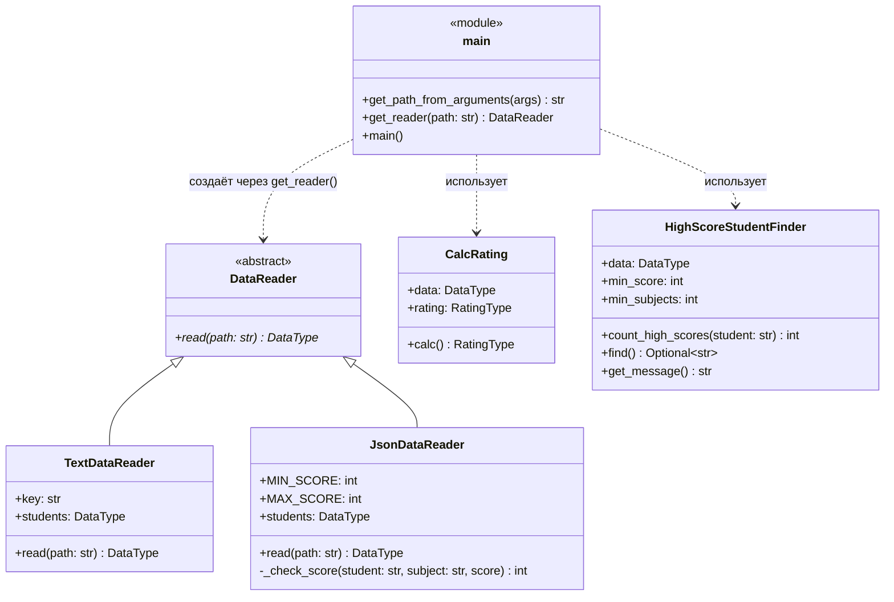

# Лабораторная 1 по дисциплине "Технологии программирования"

[](https://github.com/Modhish/PTLab1/actions/workflows/github-actions-testing.yml)

**Тема:** Знакомство с системой контроля версий Git и инструментом CI/CD GitHub Actions
**Студент:** Абдалбаки Ахмед Модхиш Хафез Мустафа
**Вариант:** 12

## Постановка задачи

Цели работы:

1. Познакомиться с распределённой системой контроля версий Git и её функциями.
2. Познакомиться с понятиями «непрерывная интеграция» (CI) и «непрерывное развёртывание» (CD), определить их место в современной разработке ПО.
3. Получить навыки разработки ООП-программ и написания модульных тестов к ним.
4. Получить навыки работы с системой Git для хранения и управления версиями ПО.
5. Получить навыки управления автоматизированным тестированием ПО, расположенного в Git, с помощью GitHub Actions.

Индивидуальное задание (вариант 12):

| Формат входного файла | Расчётная процедура |
| --- | --- |
| JSON | Определить и вывести на экран студента, имеющего 90 баллов минимум по двум дисциплинам. Если таких студентов несколько, вывести любого из них. Если таких студентов нет, вывести сообщение об их отсутствии. |

Дополнительно: выбрать лицензию, добавить `.gitignore`, вести разработку каждого класса в отдельной ветке и объединять её с главной после успешного прохождения всех тестов, составить UML-диаграмму классов.

## Описание проекта

Проект рассчитывает средний рейтинг студентов по дисциплинам и находит студента, имеющего не менее 90 баллов минимум по двум дисциплинам. Список студентов и их оценок читается из файла формата TXT или JSON; формат определяется по расширению файла.

```
rating
 |----.github/workflows/github-actions-testing.yml   # конвейер CI
 |----data
 |     |----data.txt                  # входные данные (TXT)
 |     |----data.json                 # входные данные (JSON, вариант 12)
 |----src
 |     |----Types.py                  # типы данных (Type Hints)
 |     |----DataReader.py             # абстрактный класс чтения данных
 |     |----TextDataReader.py         # чтение формата TXT
 |     |----JsonDataReader.py         # чтение формата JSON (вариант 12)
 |     |----CalcRating.py             # расчёт среднего рейтинга
 |     |----HighScoreStudentFinder.py # поиск студента с 90+ баллами по 2 дисциплинам (вариант 12)
 |     |----main.py                   # точка входа
 |----test                            # модульные тесты pytest
 |----LICENSE                         # лицензия MIT
 |----.gitignore
 |----requirements.txt
```

Формат JSON-файла:

```json
{
    "Иванов Иван Иванович": {
        "математика": 67,
        "литература": 100,
        "программирование": 91
    }
}
```

Класс `JsonDataReader` проверяет структуру файла: корневой элемент и оценки студента должны быть объектами, баллы — целыми числами в диапазоне [0; 100]; при нарушении формата выбрасывается `ValueError`.

Класс `HighScoreStudentFinder` подсчитывает для каждого студента число дисциплин с баллом ≥ 90 и возвращает первого студента, у которого таких дисциплин не меньше двух (пороги настраиваются параметрами конструктора).

## Используемые технологии

* Python 3.10 (Type Hints, модули `abc`, `argparse`, `json`)
* pytest, pytest-cov — модульное тестирование и покрытие кода
* pycodestyle — проверка соответствия стандарту PEP 8
* Git — контроль версий (ветки `json-data-reader`, `high-score-student`, слияние в `main`)
* GitHub Actions — непрерывная интеграция: при каждом push в любую ветку и при pull request в `main` выполняются проверка стиля, модульные тесты и отчёт о покрытии

## Запуск

```bash
pip install -r requirements.txt
pycodestyle src test
PYTHONPATH=./:./src/ pytest test --cov=src --cov-report=term-missing
python src/main.py -p data/data.json
```

В Windows PowerShell переменная окружения задаётся командой `$env:PYTHONPATH = "./;./src"`.

Пример вывода:

```
Students:  {'Иванов Иван Иванович': [('математика', 67), ('литература', 100), ('программирование', 91)], ...}
Rating:  {'Иванов Иван Иванович': 86.0, 'Петров Петр Петрович': 75.33333333333333, 'Сидорова Анна Сергеевна': 86.25}
Студент, имеющий 90 баллов минимум по 2 дисциплинам: Иванов Иван Иванович
```

## UML-диаграмма классов



## Тестирование

Написано 43 модульных теста (pytest), покрытие кода — 98 % (не покрыты только тело абстрактного метода и строка `if __name__ == "__main__"`):

| Модуль | Покрытие |
| --- | --- |
| CalcRating.py | 100 % |
| HighScoreStudentFinder.py | 100 % |
| JsonDataReader.py | 100 % |
| TextDataReader.py | 100 % |
| main.py | 96 % |
| DataReader.py | 83 % |

Тесты класса `JsonDataReader` проверяют корректное чтение, сохранение порядка дисциплин, пустые данные, граничные баллы 0 и 100, некорректный JSON, неверную структуру, нецелые баллы и баллы вне диапазона, отсутствующий файл, а также совместимость результата с `CalcRating`. Тесты `HighScoreStudentFinder` проверяют граничные значения (ровно 90 и 89 баллов, ровно две дисциплины), пустые данные, несколько подходящих студентов, пользовательские пороги и оба варианта выводимого сообщения. Сквозные тесты запускают `main()` с файлами TXT и JSON.

Работа CI проверена на практике: в коммите «Introduce an error in the rating calculation (CI check)» в расчёт рейтинга была внесена ошибка — тест `test_calc` обнаружил её и сборка завершилась неуспешно; после исправления в следующем коммите все тесты снова прошли.

## Выводы

1. Освоена работа с распределённой системой контроля версий Git: создание репозитория, индексация и фиксация изменений, работа с удалённым репозиторием GitHub, создание веток и их слияние с главной веткой. Каждая задача варианта выполнялась в отдельной ветке и попадала в `main` только после успешного прохождения всех тестов.
2. Настроена непрерывная интеграция с помощью GitHub Actions: каждое изменение автоматически проверяется на соответствие PEP 8 и модульными тестами, а статус проверки отображается в репозитории. Эксперимент с намеренно внесённой ошибкой показал, что CI сразу обнаруживает регрессию и не позволяет ей незаметно попасть в главную ветку.
3. Архитектура проекта, основанная на абстрактном классе `DataReader`, позволила добавить поддержку формата JSON без изменения существующих классов (принцип открытости/закрытости), а функция `get_reader` выбирает нужный класс чтения по расширению файла. Расчётные классы зависят только от типа данных `DataType`, а не от формата входного файла.
4. Модульные тесты с покрытием 98 % помогли найти и исправить ошибки ещё до слияния веток, в том числе особенность двойного импорта модулей (`src.X` и `X`), из-за которой проверка `isinstance` давала ложный результат.
